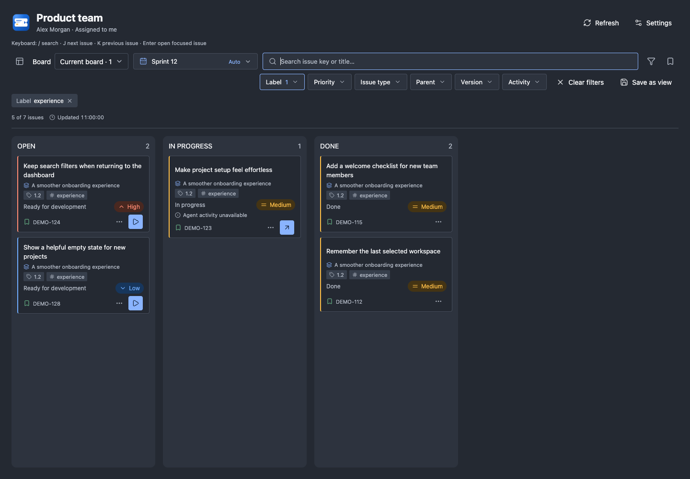
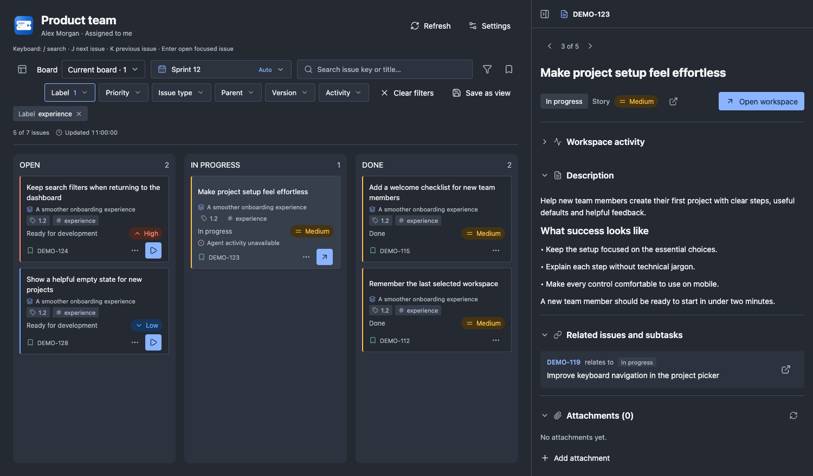

# Jira Sprint Workspace

Turn your assigned Jira sprint issues into Paseo workspaces. Browse your board, read issue details, and start an agent on an issue without leaving Paseo.



*Browser preview of the plugin's real components using fictional issues. Paseo host controls may differ.*

Install version 1.2.1 on the Paseo host:

```sh
paseo plugin install npm:paseo-jira-sprint-workspace@1.2.1
```

For an existing npm installation, run `paseo plugin update paseo-jira-sprint-workspace --version 1.2.1`. See the [release notes](https://github.com/mbranicky/jira-dashboard/releases) and [version tags](https://github.com/mbranicky/jira-dashboard/tags).

## What you can do

- **Focus the board.** Filter by Jira fields and workspace activity, save views, and switch saved boards.
- **Follow agent activity.** See linked work that is running, needs input, finished or failed without opening each workspace.
- **Make the board comfortable.** Adjust card spacing, column width and visible metadata in Settings, with a live preview and device-local preferences. Browse issues with previous/next controls and mobile column navigation.

- **Follow your sprint.** See issues assigned to you in the columns configured on your Jira board. Follow the active sprint, select a future sprint, search issues, and refresh automatically.
- **Start work from an issue.** Play creates or reuses an issue-named workspace and agent in the mapped Paseo project. Existing branches and worktrees are reused; multiple matches open a choice dialog.
- **Choose how the agent starts.** Configure a provider, model, mode and workspace isolation per Jira project. Optionally send an entry skill such as `/init-issue DEMO-123`, or leave it blank to open an agent without an initial prompt.
- **Keep Jira details close.** Open details in a modal or resizable dashboard side panel. Each workspace can also show its relevant issue in a dedicated **Jira** tab, detected from its workspace or agent name.
- **Discuss and share files.** Read comments, compose Markdown with preview, post linked replies, view attachments, preview images, and upload files on supported clients.
- **Move issues through their workflow.** Drag a card between columns. Jira determines allowed transitions; supported required fields appear in a dialog. A successful move into a configured column can also start work.

**Play does not change Jira status.** Dragging between columns requests a Jira transition. Changes made directly in Jira never launch an agent.

## A closer look

The dashboard details panel stays beside the board and remembers its selection, width and collapsed state during the client session.



On narrow screens, details fill the screen with a fixed header and scrollable content. Description, attachments and comments collapse independently.

[View the mobile preview](https://raw.githubusercontent.com/mbranicky/jira-dashboard/main/assets/mobile.png) · [View settings](https://raw.githubusercontent.com/mbranicky/jira-dashboard/main/assets/settings.png) · [View appearance controls](https://raw.githubusercontent.com/mbranicky/jira-dashboard/main/assets/appearance.png)

## Get started

Requires **Paseo 0.14.x or 0.15.x**, Jira Cloud, and a scoped Jira API token, Teamwork Graph CLI OAuth, or Atlassian MCP OAuth. The verified Paseo host is macOS on Apple silicon. Linux has automated test coverage on Ubuntu. Windows and Intel Mac hosts are unverified. Compatibility has been checked with Paseo 0.14.0, 0.15.0 and 0.15.2. Use Node 24 and npm on the daemon host; Git is required for worktree isolation.

To install from the public repository, run:

```sh
git clone https://github.com/mbranicky/jira-dashboard.git
cd jira-dashboard
npm ci
npm run typecheck
paseo plugin install "$PWD"
```

Existing `jira-dashboard` installations should follow the [ID change instructions](https://github.com/mbranicky/jira-dashboard/blob/v1.2.1/docs/GETTING_STARTED.md#updating-from-the-development-id).

1. Open **Jira Sprint Workspace → Settings**.
2. Enter your Jira board URL and choose a connection:
   - **Teamwork Graph CLI:** sign in with OAuth on the Paseo host using a named profile. Follow the [Teamwork Graph setup guide](https://github.com/mbranicky/jira-dashboard/blob/v1.2.1/docs/TWG_SETUP.md); no API token file is needed. Enable **Allow Jira changes** for moves, comments and uploads.
   - **Atlassian MCP:** complete host-browser sign-in in Settings. For writes, enable **Allow Jira changes through MCP**, reconnect for additional consent, and save. See the [MCP setup guide](https://github.com/mbranicky/jira-dashboard/blob/v1.2.1/docs/MCP_SETUP.md) and its current workflow/upload limitations.
   - **REST API:** provide the absolute path to a private `jira.env` file. Follow the [token and scope guide](https://github.com/mbranicky/jira-dashboard/blob/v1.2.1/docs/JIRA_SETUP.md).
3. Select **Test connection** to check authentication, board, sprints and issue access, then **Save connection**. Settings stay open; use **Back to board** when ready.
4. Map each Jira project key to an existing Paseo project, choose the agent settings, and optionally name an entry skill.
5. Open an issue to inspect its details, or use Play to start work.

See the [complete first-time walkthrough](https://github.com/mbranicky/jira-dashboard/blob/main/docs/GETTING_STARTED.md) for setup screenshots, branch reuse, labels and updates.

## Credentials and limits

Your API token stays in a private file on the daemon host and is sent to Atlassian for authentication. The plugin does not send the token to agents or require a hosted authentication service. Clients connected to that Paseo host share the token owner's Jira access. An entry skill runs through your selected agent provider and may access additional data according to your configuration.

TWG owns its OAuth credentials; the plugin does not read its credential files or extract tokens. TWG supports dashboard/details reads and local Start work. Jira changes are off by default; enable them explicitly for workflow moves, comments/replies and uploads. See the TWG setup guide for CLI-specific limitations.

MCP stores its OAuth grant in the host OS credential store; consent and write upgrades are explicit. MCP resolves name-only transition destinations through exact status lookup; ambiguous matches require Jira. MCP attachment preview and download were verified on macOS on Apple silicon. Uploads are available with Jira changes enabled and have been tested only with simulated responses. If the plugin cannot confirm an upload, refresh the issue’s attachments and check Jira before trying again. If the file is missing, you can upload it directly in Jira.

One Jira Cloud site is supported per host. Replies are new top-level Jira comments linked to the original; the dashboard renders recognized linked replies nested under their source comment. Attachment transfers are limited to 25 MiB and Jira's upload limit; native mobile clients have file-picker limitations. Comment drafts persist in device-local app/browser storage on desktop and web. Native clients or unavailable storage use an explicitly labelled session-only fallback. Drafts are scoped to the host, Jira site, verified account and issue.

See [known limitations](https://github.com/mbranicky/jira-dashboard/blob/main/docs/KNOWN_LIMITATIONS.md) and [connection troubleshooting](https://github.com/mbranicky/jira-dashboard/blob/main/docs/JIRA_SETUP.md#troubleshooting-and-verification). The [authentication policy review](https://github.com/mbranicky/jira-dashboard/blob/main/docs/ATLASSIAN_AUTH_POLICY.md) records why public-distribution clearance for the local-token approach is not yet established and what clarification is needed.

See the [credential security audit](https://github.com/mbranicky/jira-dashboard/blob/main/docs/CREDENTIAL_SECURITY.md) for host-side handling and its limits.

## Documentation

| Guide | What it covers |
| --- | --- |
| [Getting started](https://github.com/mbranicky/jira-dashboard/blob/main/docs/GETTING_STARTED.md) | Installation, Jira connection, project mappings and first workspace |
| [Atlassian MCP OAuth](https://github.com/mbranicky/jira-dashboard/blob/v1.2.1/docs/MCP_SETUP.md) | Host sign-in, write consent, connection checks and compatibility limits |
| [Teamwork Graph OAuth](https://github.com/mbranicky/jira-dashboard/blob/v1.2.1/docs/TWG_SETUP.md) | CLI installation, OAuth profiles, read diagnostics, opt-in writes and limitations |
| [Jira setup and scopes](https://github.com/mbranicky/jira-dashboard/blob/main/docs/JIRA_SETUP.md) | Complete token scopes, permissions, credentials and troubleshooting |
| [Connectivity options](https://github.com/mbranicky/jira-dashboard/blob/main/docs/JIRA_CONNECTIVITY_OPTIONS.md) | REST, MCP and CLI authentication alternatives and evaluation plan |
| [Known limitations](https://github.com/mbranicky/jira-dashboard/blob/main/docs/KNOWN_LIMITATIONS.md) | Supported clients and current boundaries |
| [Testing](https://github.com/mbranicky/jira-dashboard/blob/main/docs/TESTING.md) | Unit, integration and browser workflow tests using synthetic data |
| [Specification](https://github.com/mbranicky/jira-dashboard/blob/main/SPECIFICATION.md) · [Design](https://github.com/mbranicky/jira-dashboard/blob/main/DESIGN.md) | Behavior and interface decisions |
| [Changelog](https://github.com/mbranicky/jira-dashboard/blob/main/CHANGELOG.md) | Release history |
| [First-version checklist](https://github.com/mbranicky/jira-dashboard/blob/main/.claude/plans/first-version-checklist.md) · [Security review](https://github.com/mbranicky/jira-dashboard/blob/main/docs/SECRET_AUDIT.md) | Release readiness and audit evidence |

## Development

```sh
npm ci
npm run check
npm run test:ui
```

Browser tests require Google Chrome. Automated workflow tests use mocked Jira/Paseo services, require no credentials, and never connect to Jira Cloud or launch real agents. CI also checks Paseo 0.15 compatibility and scans Git history for secrets. See the testing guide for details.

Licensed under [MIT](https://github.com/mbranicky/jira-dashboard/blob/main/LICENSE). This is an independent plugin, not an Atlassian product.
