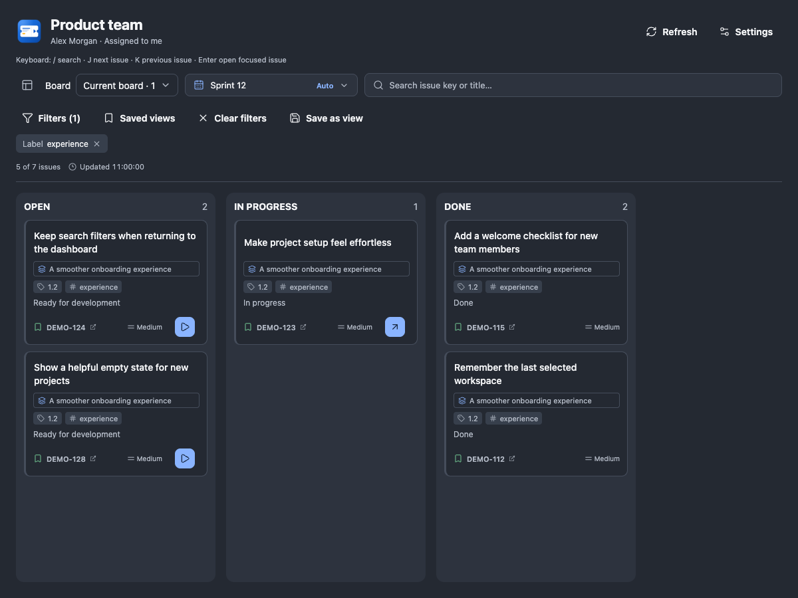
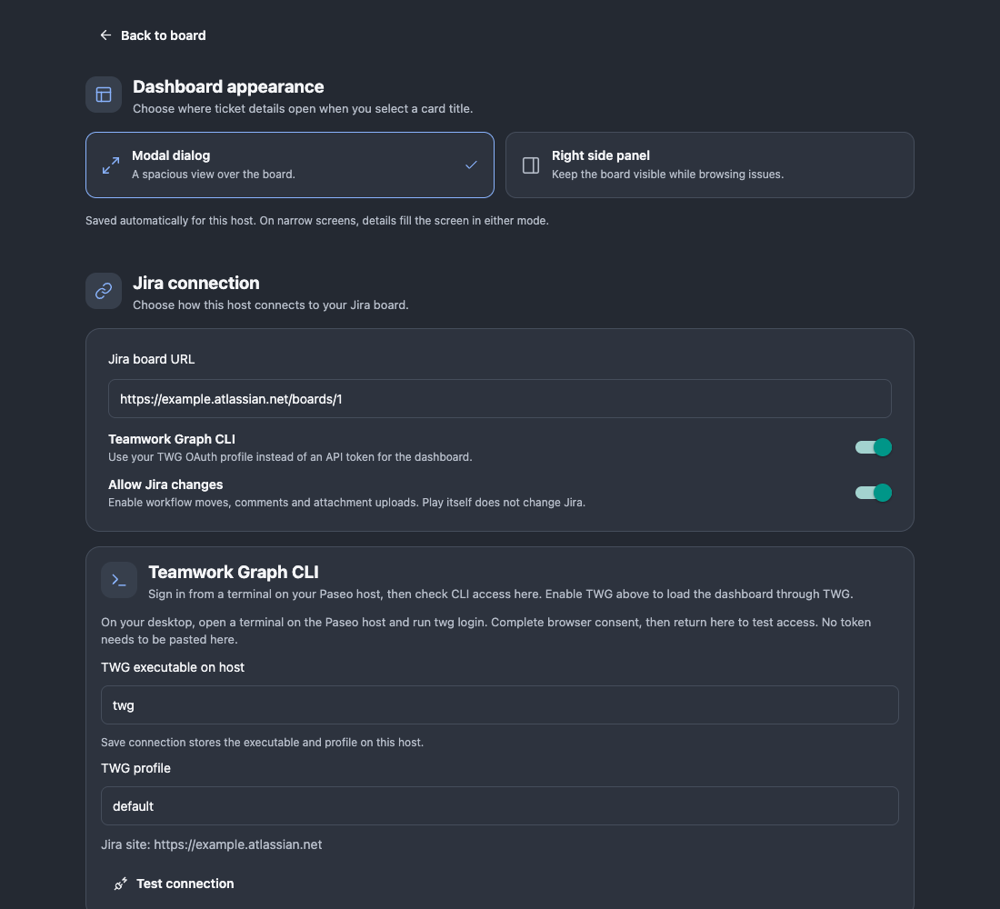
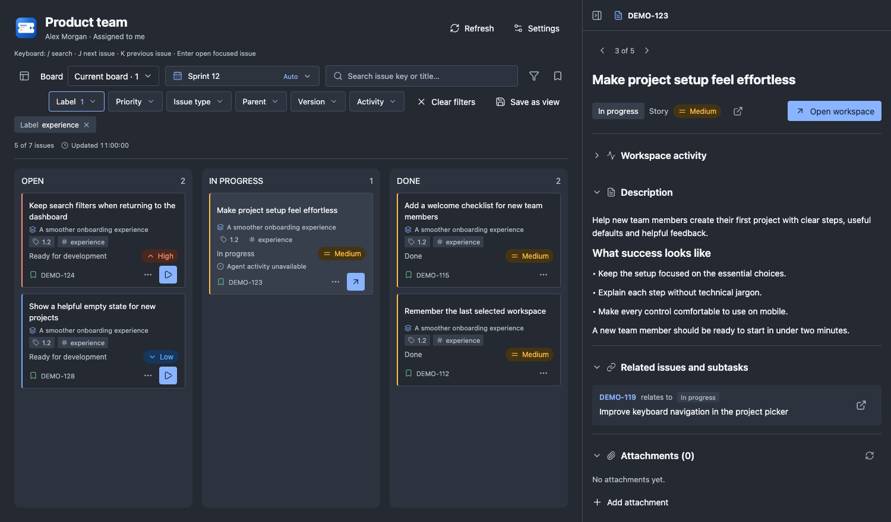
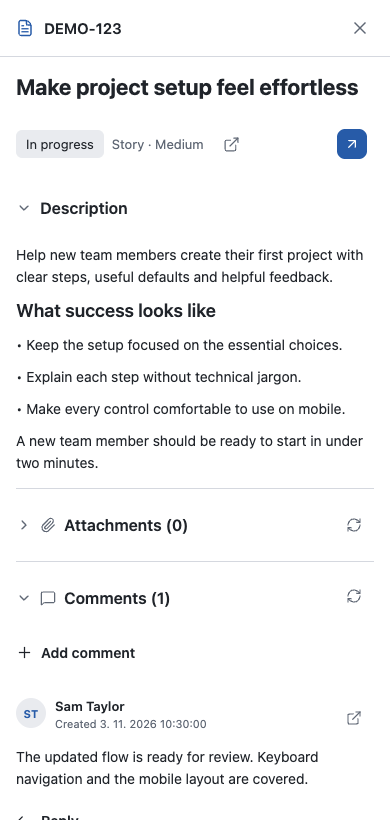

# Getting started

Jira Sprint Workspace is a trusted local Paseo plugin. Its backend connects through Atlassian MCP OAuth, a host-side Teamwork Graph OAuth profile or a private REST API credential file. Install it only on a host you trust. Install the npm release with `paseo plugin install npm:paseo-jira-sprint-workspace@1.2.0`.

## Install from a checkout

Use Paseo 0.14.x or 0.15.x, Node 24, npm, and Git on the daemon machine. The verified Paseo host is macOS on Apple silicon. Linux has automated test coverage on Ubuntu. Windows and Intel Mac hosts are unverified. See [host verification](KNOWN_LIMITATIONS.md#paseo-hosts) for details. Google Chrome is needed only for browser tests.

```sh
git clone https://github.com/mbranicky/jira-dashboard.git
cd jira-dashboard
npm ci
npm run typecheck
paseo plugin install "$PWD"
```

Enable trusted plugins in Paseo Settings → Plugins if needed. Backend plugins are unsandboxed and can access host files, credentials, processes and the network. Confirm the plugin is running with `paseo plugin ls`. Open **Jira Workspace** in the sidebar for the same host.

### Updating from the development ID

Paseo identifies installations by plugin ID. If your checkout was registered as `jira-dashboard`, record your board URL, connection settings and project mappings before switching. Disable the old registration, then install the checkout under the new default ID, `paseo-jira-sprint-workspace`. Check the new installation’s settings and re-enter them as needed. Workspace-link records and the MCP credential-store service keep their existing storage names. Reconnect through Settings if prompted.

## Connect Jira

1. Choose a connection: [Atlassian MCP OAuth](MCP_SETUP.md), [Teamwork Graph CLI OAuth](TWG_SETUP.md), or [REST with a scoped Jira token](JIRA_SETUP.md). All use the Jira account configured on the Paseo host. No password or hosted authentication service is needed.
2. Enter your board URL in Settings. For MCP, select **Atlassian MCP** and complete host-browser sign-in. For Teamwork Graph, select **Teamwork Graph CLI** and set the executable and signed-in profile. For REST, provide the absolute path to the private `jira.env` file (owner-only permissions on Unix).
3. Choose a refresh interval of at least 30 seconds. **Test connection** checks the entered values without saving: authentication, board configuration, sprints, assigned sprint issues and independent issue search. It bypasses metadata caches and does not perform writes or test write permissions.
4. Fix any failed step, then **Save connection**. Settings stay open. For Teamwork Graph, enable **Allow Jira changes** and save to use comments, uploads and workflow moves. MCP additionally requires **Allow Jira changes through MCP** and explicit reconnection for write consent; check its current compatibility limits in the setup guide.
5. Use **Back to board**. Your sprint selection is remembered per board. Auto selects the active sprint only when exactly one is active; otherwise choose a sprint explicitly.

## Map a project and start work

1. Create the target project in Paseo first, pointing to the intended repository/directory.
2. In dashboard Settings, add a mapping. Give it a name, Jira project key and target Paseo project. A board may contain issues from multiple projects; map each project you want to work on.
3. Select an agent provider and workspace isolation. Available models and modes depend on the provider. Optional model/mode values use provider defaults; isolation and provider are explicit because Paseo 0.14 does not expose all project defaults to plugins.
4. For Git worktrees, the plugin reuses an existing issue branch/worktree. Multiple matches open a choice dialog. A new issue branch starts from the branch currently checked out in the project. It never generates random branch suffixes.
5. Optionally enter an entry skill name, such as `init-issue`. The first prompt is `/init-issue DEMO-123`. Install/configure that skill yourself for the selected agent. Leaving it blank creates/opens the agent without sending a skill prompt.
6. Optionally choose **Start work on move to column**. Dropping an issue into that column starts/reuses work only after Jira accepts the transition. Play starts work without changing Jira status.
7. Save mappings; Settings stay open. Use **Back to board**, then select a suitable not-yet-started issue and click Play. This creates/reuses the issue-named workspace and agent; existing active workspaces get an Open workspace action. The workspace gets In Progress plus Story (green) or Bug (red) for the supported issue types.

Workspace creation and agent prompts are real actions. Review the selected project and skill before the first Play. Jira moves, comments and uploads are sent only through their corresponding explicit actions. Workflow forms and branch choices appear in dialogs, never inside issue cards.

## Details and daily use

Choose modal or right-side details in Settings. The desktop dashboard panel can be resized/collapsed; mobile uses full-screen details. A workspace's **Jira** tab detects the relevant issue from the workspace/agent label or an explicit plugin-created association. No issue-key entry is needed in that tab.

Descriptions, attachments and comments collapse independently. Replies are new top-level Jira comments linked to the original; the dashboard groups recognized linked replies under the original comment. Native reply creation is not implemented. Markdown is converted to ADF for REST and passed through the supported Markdown contracts for MCP/TWG. See [limitations](KNOWN_LIMITATIONS.md) and [connection troubleshooting](JIRA_SETUP.md).

## Git installation preparation

The manifest runs `npm ci --omit=dev --ignore-scripts`, then `node scripts/prepare-native.mjs` for managed Git installation. This installs locked production dependencies, including the MCP SDK and keyring helper, without dependency lifecycle scripts or development tools. Preparation records installation-local native paths; the standalone Node executable must remain available. The local-checkout walkthrough above uses the full development installation for type checks.

The package is still private and prepared for Git distribution. Publishing on npm would require a publishable runtime lock and removing redundant Git-only preparation first.

## Update a local checkout

After pulling reviewed changes, run `npm ci` and `npm run typecheck`, then `paseo plugin reload paseo-jira-sprint-workspace`. Do not restart the daemon to reload a plugin. See [Testing](TESTING.md) for developer checks and the [first-version checklist](../.claude/plans/first-version-checklist.md) for remaining release gates.

## Interface previews

These screenshots use fictional data in a browser preview of the plugin components. Paseo host controls may differ.








