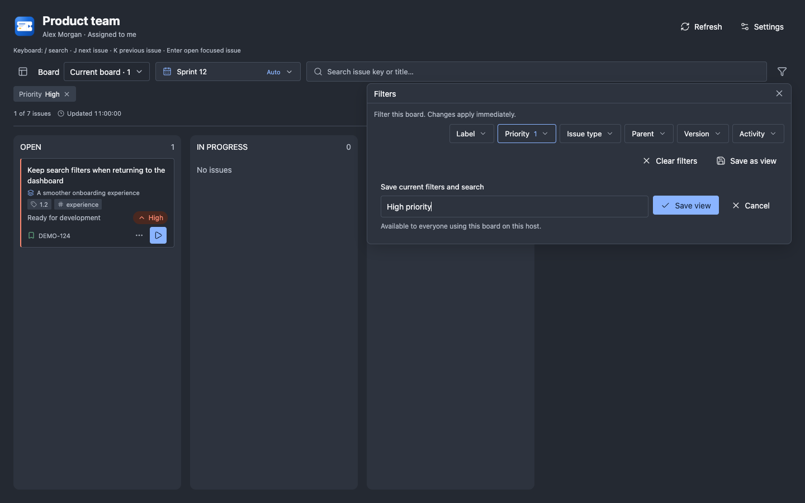
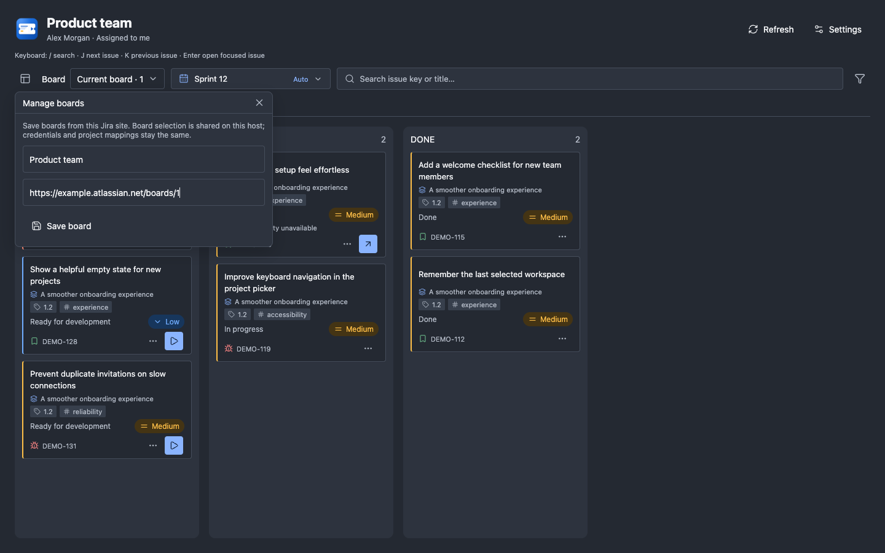
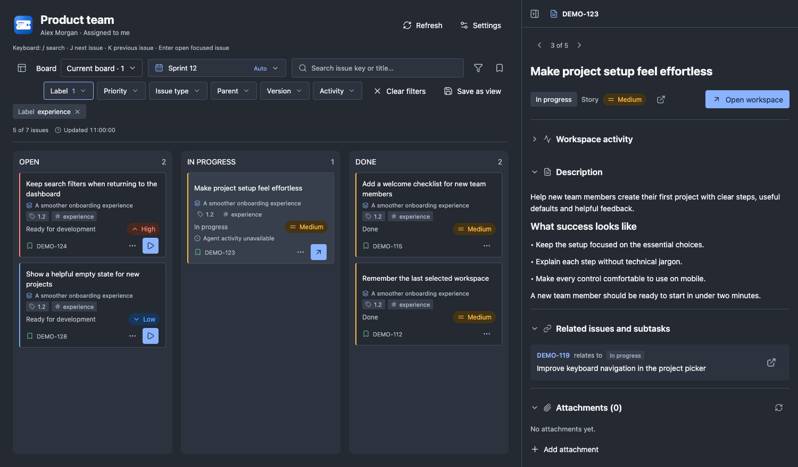
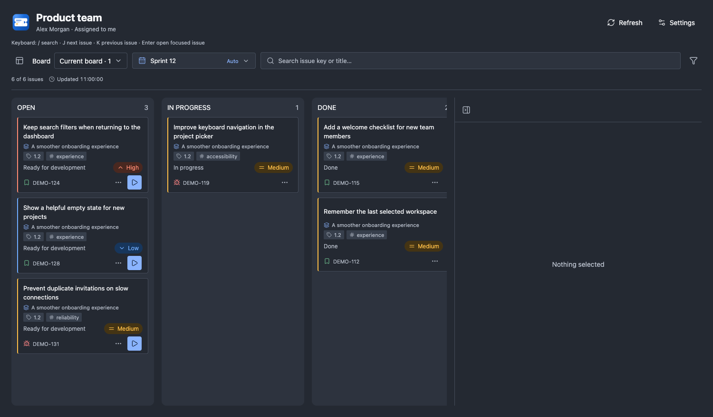
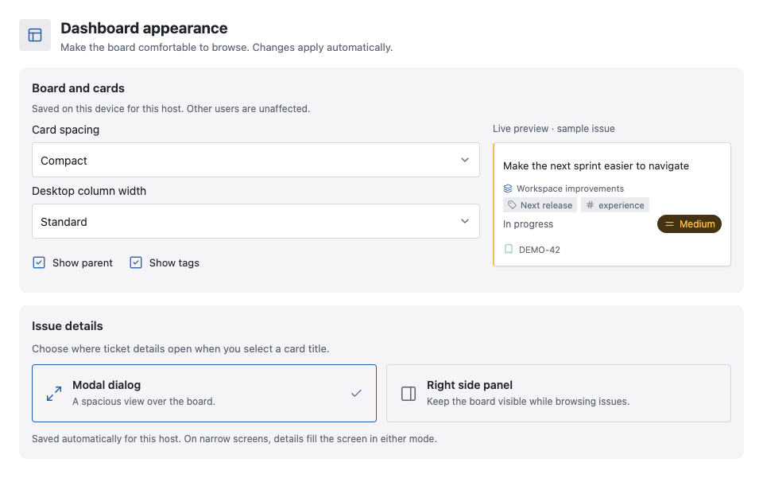
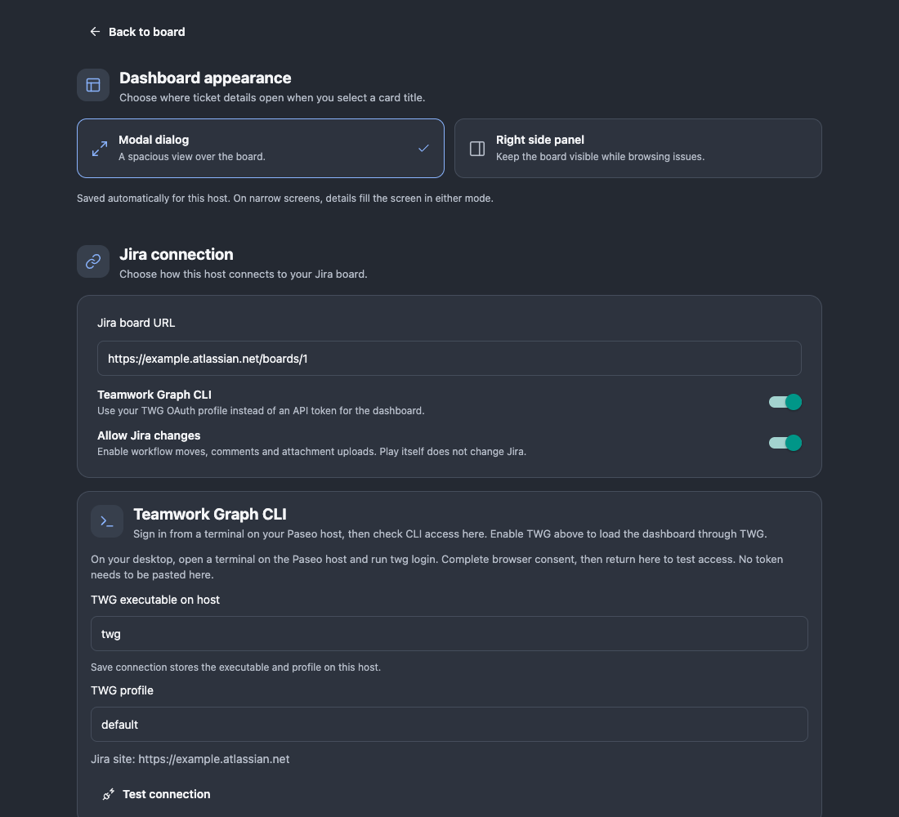
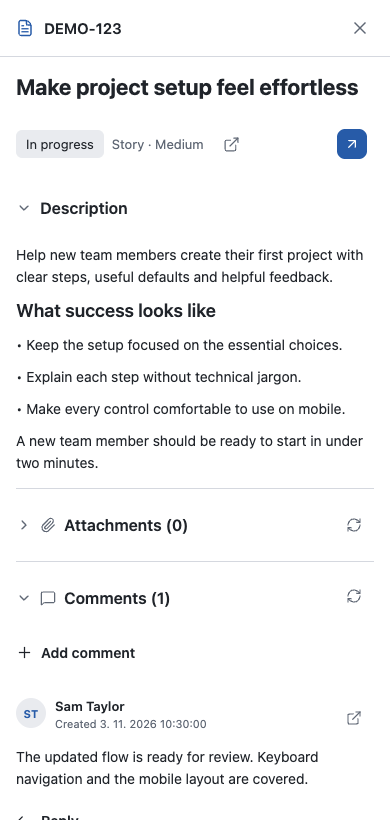
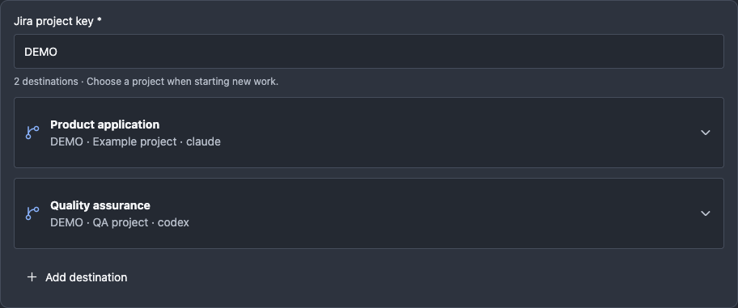
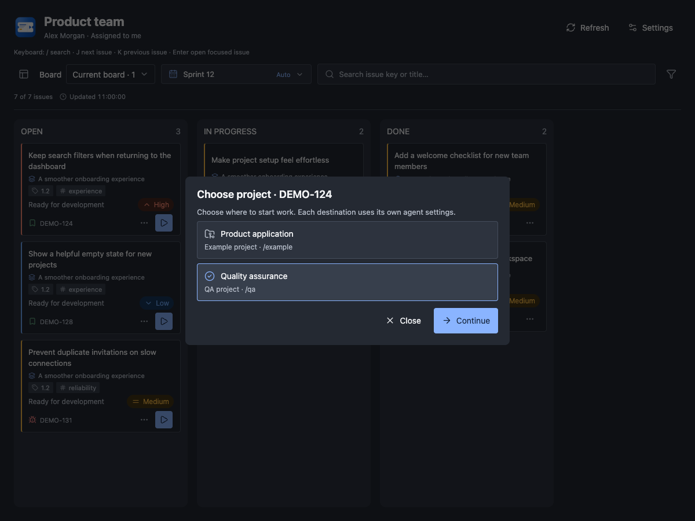

# A visual tour

These previews show Jira Sprint Workspace with fictional issues and accounts. They are captured from the plugin's components in Chrome; Paseo's surrounding controls can differ.

## Filters without moving the board

Open Filters next to search. Dropdowns stay on one row, with Clear filters and Save as view below. On narrow screens the dropdown row scrolls horizontally. Selections apply immediately; saved views let you return to a useful combination.

## Manage boards in place

The board-management button opens a compact form beside the board selector. Save a name and Jira board URL without moving the columns. Saved boards are shared on the host; changing boards retains the connection and project mappings.

## Details below the toolbar

The resizable details panel sits beside the columns. Search, sprint and board selection, filters, refresh and settings remain above both areas. The panel and columns scroll independently.

When a successful refresh removes the selected issue from the board, the expanded panel shows **Nothing selected**. Selecting another card fills it again. Search filters and failed refreshes do not clear the selection.

## Appearance on your device

Choose card spacing and desktop column width, and whether to show parent issues and tags. The preview updates immediately. These preferences apply to this device for the current host.

## Connection diagnostics

REST API, Teamwork Graph CLI and Atlassian MCP are supported. The example below shows MCP's read-only connection test. See [Getting started](GETTING_STARTED.md) for setup and [Jira setup](JIRA_SETUP.md) for authentication details.

## Mobile details

On narrow screens, details use a full-screen view with a fixed header. Description, attachments and comments can be collapsed independently.

## One Jira project, several repositories

Keep destinations together in one mapping card. Each destination has its own Paseo project, agent preferences, entry skill and workspace isolation. Save becomes available only when settings change.

When starting work on an issue with several destinations, choose a project before branch selection and creation. Start work on move also asks for the eligible destination before confirmation. Existing linked workspaces open directly.

## Workspace labels per destination

Enable **Label workspaces by issue type** to add Story, Bug or Test labels when starting work. The default is on. Each destination can opt out independently without removing existing labels.

